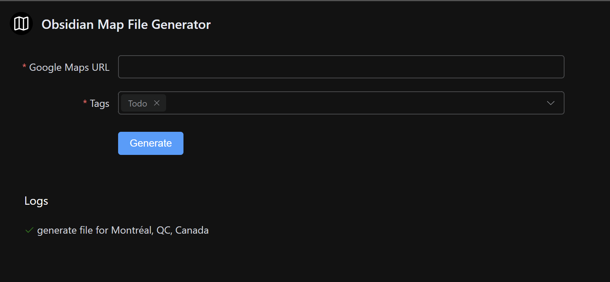

# Obsidian Map File Generator

A quick and dirty project to generate a markdown file for the [Obsidian Bases map view](https://obsidian.md/help/bases/views/map) from a Google Maps place URL.

## Screenshot



## How to use it

```
git clone https://github.com/Gyskard/obsidian-map-file-generator
npm install
npm run dev
```

Paste a Google Maps place URL, select tags and generate. With Chrome, Edge or another Chromium browser, you can choose the destination folder (for example the `Places` folder of your vault) and you are asked before replacing an existing file. Otherwise the file is downloaded.

Generated file:

```
---
coordinates:
  - "41.6880083"
  - "44.8109444"
type: "[[todo]]"
tags:
  - roadtrip
---
```

## Types

Place types are listed in `src/config/tags.ts`. The first selected type becomes the `type` property, other selected values (or new values typed in the field) become `tags`.

Each type is a note of your vault holding the marker icon ([Lucide](https://lucide.dev/icons) name) and color, for example `todo.md`:

```
---
icon: "list"
color: "#2b2b2b"
---
```

In your base, add these formulas and use them as marker icon and color, with `coordinates` as marker coordinates:

```
formulas:
  typeIcon: if(type, list(type)[0].asFile().properties.icon, "circle")
  typeColor: if(type, list(type)[0].asFile().properties.color, "var(--color-blue)")
```

## Built With

* VueJS
* Pinia
* ElementPlus
